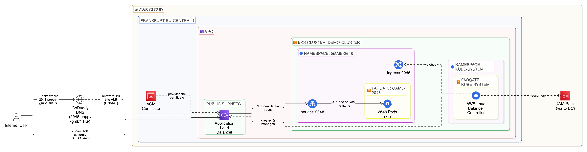

# Kubernetes on EKS – 2048 App

## Introduction

Deploying the 2048 game on Amazon EKS with Fargate, exposed to the internet via Kubernetes Ingress and an Application Load Balancer managed by the AWS Load Balancer Controller.

## Architecture Diagram

## Notes

- **Why EKS?** – managed control plane, so the focus stays on the application.
- **Why Fargate?** – no worker nodes to create, patch or scale.
- **Why Ingress?** – one ALB with routing rules instead of a separate load balancer per Service.

## Challenges & How I Resolved Them

### Upgrading from HTTP to HTTPS

**Problems:** 
- The app was only available over plain HTTP through the ALB's default address. 
- It worked in laptop browsers, but on phones the page just timed out. Modern browsers, especially on mobile, automatically try HTTPS first, and the ALB only listened on port 80, so those requests never got an answer. 
- On top of that, the long ALB address isn't something anyone would type or remember.

**Solution:** I upgraded the app to HTTPS with my own subdomain:

1. **Requested a certificate** in AWS Certificate Manager (ACM) for `2048.poppy-gmbh.site`, in the same region as the ALB.
2. **Validated the domain** by adding the CNAME record from ACM to my DNS at GoDaddy.
3. **Updated the Ingress** (`ingress-https.yaml`) to listen on ports 80 and 443, use the ACM certificate, redirect HTTP to HTTPS, and only respond to my domain.
4. **Pointed the subdomain to the ALB** with a CNAME record in GoDaddy.

**Result:** The game is now available at `https://2048.poppy-gmbh.site` on any device. Anyone opening the HTTP version is automatically redirected to HTTPS.